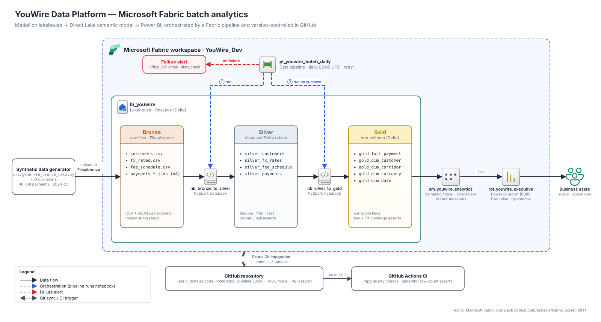
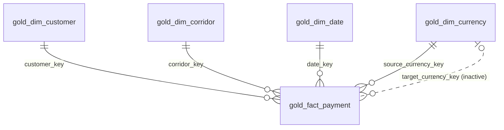

# YouWire Data Platform

[](https://github.com/manaf-dev/YouWire-Data-Platform/actions/workflows/quality-checks.yml)


An end-to-end **Microsoft Fabric** batch analytics platform for **YouWire**, a fictional cross-border B2B payments company. Raw payment, customer and FX files land in a OneLake lakehouse. PySpark notebooks refine them through a **Bronze → Silver → Gold** medallion into a star schema. A **Direct Lake** semantic model and Power BI report serve the result to the business. A Fabric pipeline orchestrates the run and emails on failure.

Every Fabric item is stored here as code through **Fabric Git integration**, so the whole platform can be rebuilt from this repository.

> **Business question:** *How is YouWire performing by payment corridor, currency and customer segment, and where are payments failing or settling slowly?*

## Architecture




| Stage | What happens |
|---|---|
| **Ingest** | A seeded generator produces realistic, deliberately messy CSV and JSON files. They're uploaded to `Files/bronze` in the `lh_youwire` lakehouse. |
| **Bronze → Silver** | `nb_bronze_to_silver` deduplicates, trims, normalises casing and casts types, then writes four Silver Delta tables. It stops the run if any payment has a missing ID or an unknown customer. |
| **Silver → Gold** | `nb_silver_to_gold` builds a star schema: four dimensions with `row_number()` surrogate keys, plus a payment fact enriched with daily FX rates. It asserts that row counts reconcile and that every key and FX rate resolves. |
| **Orchestrate** | `pl_youwire_batch_daily` runs Silver, then Gold on success. Each step retries once. If either step fails, an Office 365 email goes to the `alert_email` parameter. |
| **Serve** | `sm_youwire_analytics` reads the Gold Delta tables in **Direct Lake** mode, with no import or refresh copy. `rpt_youwire_executive` presents it to executives and operations. |
| **Version & verify** | Fabric Git integration syncs the workspace with this repo. GitHub Actions checks the repo structure and runs the data generator on every push and PR. |

## Fabric items

| Item | Type | Purpose |
|---|---|---|
| [`lh_youwire`](lh_youwire.Lakehouse) | Lakehouse | OneLake storage for all three medallion layers |
| [`nb_bronze_to_silver`](nb_bronze_to_silver.Notebook/notebook-content.py) | Notebook (PySpark) | Cleanses raw CSV/JSON into Silver Delta tables, with data quality asserts |
| [`nb_silver_to_gold`](nb_silver_to_gold.Notebook/notebook-content.py) | Notebook (PySpark) | Builds the Gold star schema, with reconciliation and key/FX coverage asserts |
| [`pl_youwire_batch_daily`](pl_youwire_batch_daily.DataPipeline/pipeline-content.json) | Data pipeline | Orchestration, retries and failure alerting. Daily 02:00 UTC schedule, off by default |
| [`sm_youwire_analytics`](sm_youwire_analytics.SemanticModel/definition) | Semantic model (TMDL) | Direct Lake star schema with 10 DAX measures |
| [`rpt_youwire_executive`](rpt_youwire_executive.Report/definition) | Power BI report (PBIR) | *Executive Overview* and *Operations* pages |

## Data model



- **Grain:** one row per payment (48,788 rows).
- **Role-playing currency dimension:** the source currency relationship is active. The target currency relationship is inactive and switched on by `USERELATIONSHIP` in the *Payment Volume USD by Target Currency* measure.
- `gold_dim_date` is marked as the model's date table, and surrogate keys are hidden from report authors.

### Measures

| Measure | Definition |
|---|---|
| Total Payment Volume USD | Value of **completed** payments. Failed and pending payments are excluded |
| Attempted Payment Volume USD | Value of every initiated payment, whatever its outcome |
| Total Fees USD | Fee revenue earned on completed payments |
| Payment Count / Completed / Failed | Row counts by outcome |
| Success Rate / Failure Rate | Completed ÷ all, and failed ÷ all |
| Avg Settlement Hours | Mean time from initiation to completion, for completed payments |
| Payment Volume USD by Target Currency | Completed volume, sliced by destination currency through the inactive relationship |

### Report

- **Executive Overview:** KPI cards for volume, fees, payment count and success rate; volume by corridor; volume split by customer segment.
- **Operations:** a monthly payment-count trend and a corridor table showing failed count and failure rate, with slicers for segment, status and payment method.

## Data

The dataset is synthetic and generated by [`src/generate_bronze_data.py`](src/generate_bronze_data.py). The script uses only the Python standard library and a fixed seed, so every run produces identical files. It also asserts the expected row counts.

| Bronze file | Rows | Notes |
|---|---|---|
| `customers/customers.csv` | 750 | 10 countries, SME and Enterprise segments, KYC status |
| `payments/payments_<year>_h<n>.json` | 48,788 | 4 half-year files covering Jan 2024 to Dec 2025, with growth and weekend seasonality |
| `fx_rates/fx_rates.csv` | 6,579 | Daily USD rates for 9 currencies (random walk; AED pegged) |
| `fee_schedule/fee_schedule.csv` | 16 | Fee % by segment, payment method and corridor type |

Some rows are deliberately dirty, with stray whitespace and mixed-case codes and statuses, so the Silver cleansing does real work. Failure rates and settlement times vary by destination corridor, giving the Operations page something to find. Headline figures from the generated data: **100 corridors**, **96.0 % success rate**, **≈ $1.19 B completed volume**, **≈ $12.6 M fees** and **17.3 h average settlement**.

## Run it yourself

**Prerequisites:** a Fabric capacity (a trial works), Python 3.10+, and a fork of this repo.

1. **Generate the data.**
   ```bash
   python src/generate_bronze_data.py
   ```
   This writes to `data/bronze/`, which git ignores. The script can also write straight to OneLake from a Fabric notebook with `--out /lakehouse/default/Files/bronze`.
2. **Create a workspace and connect it to Git.** Go to *Workspace settings → Git integration*, point it at your fork's `main` branch and choose **Update all**. Fabric creates the lakehouse, notebooks, pipeline, semantic model and report.
3. **Load Bronze.** In `lh_youwire`, upload the contents of `data/bronze/` into `Files/bronze`.
4. **Rebind workspace-specific references.** These IDs are tied to the original workspace:
   - In each notebook, set `lh_youwire` as the default lakehouse.
   - Point the semantic model at your lakehouse. Either update the OneLake URL in [`expressions.tmdl`](sm_youwire_analytics.SemanticModel/definition/expressions.tmdl), or run semantic-link-labs' `directlake.update_direct_lake_model_connection(dataset="sm_youwire_analytics", source="lh_youwire", source_type="Lakehouse")` from a Fabric notebook.
   - In the pipeline, create an Office 365 connection for the alert activity and set the `alert_email` parameter.
5. **Run `pl_youwire_batch_daily`.** Direct Lake picks up the new Gold tables automatically, and the report is ready.
6. *(Optional)* Turn on the daily schedule in the pipeline settings.

## Engineering decisions

- **Full-overwrite loads.** Every layer is rebuilt on each run, so the pipeline is idempotent and safe to retry. This suits a dataset of this size. The next step would be incremental `MERGE` loads keyed on `payment_id`.
- **Deterministic surrogate keys.** `row_number()` over the natural key gives compact, stable integers. `monotonically_increasing_id()` gives large, gappy keys that change between runs.
- **Fail loudly.** Data quality checks are hard `assert`s, so a bad load fails the pipeline and triggers the alert instead of publishing wrong numbers.
- **Direct Lake over Import.** The report reads Gold Delta tables directly, with no scheduled dataset refresh and no duplicate storage.
- **Business-correct metrics.** Volume and fee revenue count completed payments only. Attempted volume is a separate measure, so the difference stays visible.
- **Everything as code.** TMDL (model), PBIR (report), pipeline JSON and notebook source all live in Git. CI catches structural breakage before Fabric syncs it.

## Repository layout

```
├── .github/workflows/quality-checks.yml   CI: repo structure checks + data generator
├── docs/architecture/                     Architecture diagram (.drawio source + .svg)
├── lh_youwire.Lakehouse/                  Lakehouse definition
├── nb_bronze_to_silver.Notebook/          Bronze → Silver PySpark notebook
├── nb_silver_to_gold.Notebook/            Silver → Gold PySpark notebook
├── pl_youwire_batch_daily.DataPipeline/   Pipeline definition + schedule
├── sm_youwire_analytics.SemanticModel/    Direct Lake semantic model (TMDL)
├── rpt_youwire_executive.Report/          Power BI report (PBIR)
└── src/
    ├── generate_bronze_data.py            Synthetic Bronze data generator
    └── quality_checks.py                  Repository structure checks used by CI
```

## Tech stack

Microsoft Fabric (Lakehouse, OneLake, Notebooks, Data Pipelines, Git integration) · PySpark · Delta Lake · Direct Lake semantic model (TMDL) · DAX · Power BI (PBIR) · Python · GitHub Actions

## Credits

Architecture icons come from the [Microsoft Fabric & Azure icon pack](https://github.com/astrzala/FabricToolset) by [astrzala](https://github.com/astrzala) (MIT), via [dataguideline.com](https://dataguideline.com/a-complete-set-of-microsoft-fabric-icons-for-solution-architects/). YouWire is a fictional company, and all data is synthetic.
